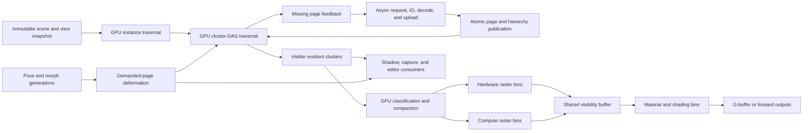

# TerraEngine Virtual Geometry: Beyond-Nanite Research and Delivery Plan

**Status:** Pre-implementation research and architecture plan
**Research baseline:** 2026-07-29
**Comparison baseline:** Unreal Engine 5.8.0, commit `7deeb413d3dc1fc034f48d1aacc0861301829d32`

## 1. Executive Decision

TerraEngine should not attempt to reproduce Unreal Engine Nanite feature-for-feature.
That would create a long-running compatibility chase against a mature production
renderer without giving TerraEngine a durable reason to exist.

The recommended product goal is:

> Build a portable, deterministic, failure-transparent cluster-geometry platform
> with first-class page-granular skinning and morph deformation, shared raster
> geometry across every view and pass, and independently verifiable performance.

This direction first requires closing the fundamental execution gaps with Nanite:
GPU hierarchy traversal, GPU-authored submission, demand-driven streaming, a
visibility buffer, compressed page decoding, and hybrid hardware/compute
rasterization. TerraEngine should then differentiate through:

- first-class animated virtual geometry rather than treating animation as an
  exceptional fallback;
- morph-target support, including position, normal, and tangent deformation;
- one independently designed compressed representation usable by rasterization
  and deformation;
- explicit source-labelled diagnostics and conservative failure behavior;
- reproducible cross-vendor results rather than undocumented performance claims;
- backend portability across Vulkan, DirectX 12, mesh-shader, compute, and
  conventional fallback routes.

The work must be delivered as a sequence of independently useful milestones.
No milestone may advertise a GPU capability merely because its records, buffers,
or shader source exist. A capability becomes supported only after the backend
executes it and GPU evidence verifies it.

## 2. Evidence and Current Baseline

### 2.1 TerraEngine strengths

The current implementation already provides valuable foundations:

- adaptive detail records and a non-overlapping per-view cluster cut;
- conservative parent/child and fallback coverage validation;
- page state, retry, retirement, and pinned-fallback contracts;
- page-local geometry streams consumed by the mesh-shader route;
- per-view, shadow-view, residency, and failure diagnostics;
- conservative Hi-Z and cone-culling fallbacks;
- immutable render snapshots and generation-labelled publication;
- page-granular animated geometry planning, deformation, current bounds, and
  generation checks;
- deterministic CPU contracts and a broad virtual-geometry test suite.

These strengths should be preserved. They are especially valuable for animated
content and for diagnosing missing geometry without relying on a GPU debugger.

### 2.2 TerraEngine gaps that must be stated accurately

The current implementation is not yet an end-to-end GPU-driven renderer:

- `RenderSystem` builds GPU packet records, generated submissions, and prepared
  compaction results on the CPU.
- Vulkan creates mesh-task indirect commands on the CPU and copies them through
  mapped CPU-visible memory.
- `VirtualGeometryPacketCompaction.comp.hlsl` is compiled, but the Vulkan
  backend does not currently create and dispatch its compute pipeline.
- Backend capability reporting equates mesh-shader availability with GPU
  compaction and generated-submission support.
- GPU timestamp-query samples for the relevant views are not yet authoritative.
- Most scale checks are deterministic synthetic tests, not captured GPU
  benchmarks over production assets.
- The base virtual-geometry documentation still contains static-only language
  that does not fully describe the newer animated path.

The first milestone must correct capability truth and establish measurements.
Otherwise later comparisons will be built on misleading labels.

### 2.3 Unreal Engine 5.8 implementation observations

The inspected Unreal fork confirms that Nanite currently includes:

- compute-driven hierarchy and cluster traversal;
- GPU-created indirect work;
- indirect hardware mesh-shader rasterization;
- indirect compute software rasterization;
- hardware/software raster bins and material/shading bins;
- two-pass occlusion and post-pass recovery;
- GPU feedback feeding asynchronous page streaming;
- dependency-aware page installation and hierarchy fixups;
- fixed-size streaming pools, root pages, priorities, and LRU management;
- a cluster DAG builder with repeated grouping, simplification, and parent
  generation;
- compressed topology, positions, attributes, materials, and skinning data;
- dedicated paths for skeletal meshes, tessellation, splines, curves, voxels,
  foliage, shadows, and visualization.

TerraEngine must match the architectural depth of the first ten items before a
general claim of superiority is credible.

## 3. Definition of “Better”

“Better than Nanite” must never mean a subjective screenshot or a larger source
triangle count. A claim is allowed only when it names the workload, hardware,
quality level, and measurement.

TerraEngine should pursue four forms of superiority:

1. **Animated-content superiority**
   - lower deformation and residency cost for skinned and morphed dense meshes;
   - page-demand-driven deformation shared by all views;
   - position, normal, and tangent morph fidelity;
   - stable dynamic bounds and conservative visibility.

2. **Portability superiority**
   - equivalent visibility semantics on Vulkan and DirectX 12;
   - mesh-shader, compute-raster, and indexed fallback routes;
   - compressed data that does not require one vendor's future hardware;
   - optional acceleration when standardized dense-geometry hardware exists.

3. **Reliability and observability superiority**
   - no silent holes, partial page publication, or false authoritative zeros;
   - exact frame/view/generation ownership for every decision;
   - a CPU oracle and deterministic replay for every GPU visibility stage;
   - actionable failure reasons visible in runtime and editor tooling.

4. **Measured efficiency superiority**
   - competitive or lower disk bytes per triangle;
   - competitive or lower resident bytes per visible triangle;
   - lower CPU render-preparation cost;
   - competitive GPU frame time and materially better animated workloads;
   - lower frame-time variance under streaming and deformation churn.

Static opaque performance parity is a prerequisite. Animated superiority and
portability are the intended differentiators.

## 4. The Three Work Categories

### Category A: Geometric Quality

This category owns what geometry exists, how it is simplified and represented,
and whether arbitrary detail cuts remain visually and topologically valid.

It includes:

- attribute-aware cluster-DAG construction;
- boundary, material, UV seam, normal, tangent, and skinning preservation;
- accumulated object-space and screen-space error;
- watertight global-grid quantization;
- compressed cluster and page encoding;
- parent/child coverage and transition correctness;
- aggregate geometry, curves, foliage, and voxel or impostor transitions;
- deformation-aware cluster construction and dynamic bounds;
- stable triangle identity shared by visibility, shading, picking, and debugging.

Success means that a per-view cluster cut can vary spatially within one object
without cracks, duplicated surfaces, material corruption, or visible popping.

### Category B: Engine Integration

This category owns how geometry becomes visible and how it interacts with the
rest of a frame.

It includes:

- GPU instance and cluster traversal;
- GPU packet compaction and indirect submission;
- GPU feedback streaming and dependency-aware page installation;
- visibility-buffer rendering;
- hybrid hardware and compute rasterization;
- material and shading bins;
- two-pass occlusion;
- animation, morph, procedural deformation, and multi-view reuse;
- virtual shadows, captures, and reflections;
- renderer scheduling, synchronization, budgets, and recovery;
- backend capability negotiation and fallback routes.

Success means CPU work scales primarily with views, bins, and streaming
transactions—not with the number of visible clusters or triangles.

### Category C: Product Maturity

This category owns whether the technology can be trusted and used by developers
and artists.

It includes:

- reproducible GPU timestamp and profiler captures;
- a representative content and hardware benchmark matrix;
- long-running streaming/deformation soak tests;
- deterministic cook output and incremental rebuilds;
- derived-data caching and build cancellation;
- importer and editor workflows;
- per-asset memory, quality, and failure inspection;
- cross-vendor image and performance validation;
- installed-build, package, and upgrade compatibility;
- documentation and truthful capability reporting;
- licensing and clean-room implementation controls.

Success means a clean checkout can build, install, import representative
high-density assets, render them correctly, and reproduce published results.

## 5. The Original Seven Ideas

The following seven ideas remain required. They are preserved here explicitly
and assigned to the larger architecture.

### Idea 1: Execute real GPU packet compaction

Replace CPU-authored “compaction results” with a Vulkan compute pass that reads
candidate packets and writes compacted visible, rejected, and fail-open packet
streams plus authoritative counters.

Required properties:

- one immutable input snapshot per frame and view;
- bounded output capacity with overflow detection;
- explicit frustum, Hi-Z, cone, residency, and fail-open classifications;
- GPU counter readback tagged with frame, view, and renderer generation;
- CPU oracle comparison in validation builds;
- no capability flag until the Vulkan dispatch and readback are proven.

### Idea 2: Generate indirect arguments entirely on the GPU

The GPU must convert compacted work into indirect compute, mesh-shader, and
hardware-raster arguments without per-cluster CPU iteration or mapped-memory
command construction.

Required properties:

- count and non-count indirect fallback based on backend support;
- capacity and alignment validation;
- generation-safe buffer reuse;
- zero-work submissions represented without fake draws;
- a conventional CPU fallback that is diagnostic, not the normal route.

### Idea 3: Move hierarchy traversal and LOD selection onto the GPU

The GPU must traverse instance and cluster hierarchies using per-view projected
error, residency, and visibility. The CPU implementation remains the correctness
oracle and fallback.

Required properties:

- non-overlapping parent/child cuts;
- accumulated geometric error;
- resident-ancestor substitution;
- request emission for missing desired children;
- view-local temporal stability;
- separate camera, shadow, capture, and reflection policies;
- bounded traversal queues with overflow recovery.

### Idea 4: Add GPU compute software rasterization

Add a compute-shader rasterizer for clusters dominated by small or subpixel
triangles. “Software” means programmable GPU compute; it does not mean CPU
rendering.

Required properties:

- shared visibility-buffer output with hardware rasterization;
- near-plane clipping and a documented fill convention;
- conservative depth conversion and deterministic tie-breaking;
- atomic visibility updates;
- triangle and barycentric reconstruction;
- large-triangle rejection to the hardware route;
- hardware/compute image parity tests.

### Idea 5: Implement compressed page encoding and GPU transcode/decode

Replace expanded page-local streams with an independently designed, versioned,
block-based codec optimized for random cluster access and parallel decoding.

Required properties:

- globally anchored fixed-point positions to prevent cracks;
- per-cluster or per-block offsets and variable precision;
- compact topology such as generalized strips or another measured codec;
- quantized normals, tangents, UVs, colors, material IDs, and skin weights;
- separately versioned optional morph and deformation streams;
- CPU reference decoder and GPU decoder parity;
- format capability flags rather than implicit layout assumptions;
- evaluation of AMD DGF/DGFS as an optional permissively licensed backend or
  research baseline, without making one vendor format mandatory.

### Idea 6: Add reproducible GPU benchmarks and timestamp queries

Instrument every virtual-geometry stage with real GPU timestamps and capture
metadata. Replace synthetic timing implications with evidence.

Required properties:

- timestamps for traversal, compaction, streaming updates, hardware raster,
  compute raster, visibility resolve, shading, deformation, shadows, and ray
  tracing;
- delayed query handling that never reports unavailable data as zero;
- adapter, driver, resolution, quality, view count, and revision capture;
- median, p95, p99, variance, and warm-up policy;
- exportable machine-readable benchmark results;
- RGP, RenderDoc, Nsight, or PIX marker regions where supported.

### Idea 7: Expand content, platform, and renderer integration

Expand beyond the initial static opaque Vulkan mesh-shader route.

Required properties:

- opaque and masked material support;
- programmable vertex and pixel material features;
- Vulkan and DirectX 12;
- mesh-shader, compute-raster, and indexed fallbacks;
- landscapes, foliage, aggregate geometry, curves, and splines;
- virtual-shadow and lighting integration;
- reflection and capture integration;
- skeletal animation, morphs, procedural deformation, and tessellation.

## 6. Additional Required Architecture

The original seven ideas are necessary but not sufficient. The following
workstreams make them a coherent production renderer.

### 6.1 Attribute-aware cluster DAG

The current Morton-region hierarchy should evolve into a genuine cluster DAG:

1. Build fine clusters with bounded triangle and vertex counts.
2. Group adjacent clusters using topology, spatial locality, material
   compatibility, and boundary cost.
3. Merge each group into a simplification domain.
4. Simplify positions and important attributes under a measured error budget.
5. Split the result into bounded parent clusters.
6. Accumulate error from descendants into parents.
7. Repeat until root coverage is small and always resident.

The builder must protect:

- open and non-manifold boundaries where required;
- material and shading discontinuities;
- UV seams and tangent discontinuities;
- hard edges;
- skinning partitions and maximum joint palettes;
- morph envelopes;
- authored “never simplify” and importance masks.

The open-source `meshoptimizer` attribute-aware and regularized simplification
interfaces are useful baselines. They should be benchmarked rather than assumed
to be the final hierarchy algorithm.

### 6.2 Visibility buffer and deferred material evaluation

Geometry visibility should be separated from material evaluation. Hardware and
compute raster routes write a compact visibility record. A later stage:

1. validates the record generation;
2. reconstructs triangle vertices and barycentrics;
3. evaluates attributes and derivatives;
4. assigns the pixel to a shading bin;
5. evaluates the material;
6. writes the G-buffer or forward result.

The initial record layout should be evaluated, not prematurely frozen. Candidate
formats include:

- 64-bit packed depth and primitive identity for the common path;
- a wider auxiliary record for large instance/page/triangle spaces;
- separate depth and identity images when atomics or format support require it.

The design must specify deterministic depth ties, MSAA behavior, derivative
reconstruction, alpha testing, and editor picking before implementation.

### 6.3 GPU instance hierarchy

Cluster traversal alone is insufficient when scenes contain millions of
instances. Add a GPU-visible world hierarchy above geometry:

```text
world cell
  -> instance group
    -> instance
      -> cluster DAG root
        -> selected clusters
```

The hierarchy must support:

- world-partition streaming;
- static and dynamic instance partitions;
- transform and bounds generations;
- previous-frame visibility reuse;
- per-view filtering;
- coarse frustum and occlusion rejection;
- conservative dynamic-object handling;
- bounded updates through immutable snapshots.

### 6.4 Two-pass occlusion

Use a main/post model:

1. Traverse using the previous compatible HZB.
2. Render accepted occluders.
3. Build or update current depth information.
4. Revisit previously occluded or uncertain work.
5. Render newly exposed work in the post pass.

Camera cuts, resize, projection changes, teleports, and incompatible depth-scene
generations must invalidate history. Uncertainty fails open to the post pass
rather than immediately expanding the entire highest-detail mesh.

### 6.5 GPU-feedback streaming

The traversal shader should emit missing page keys with a priority derived from:

- projected error benefit;
- visible pixel estimate;
- view type and importance;
- distance and predicted camera motion;
- fallback quality;
- request age;
- shadow or reflection reuse;
- animation/deformation cost.

The CPU streaming coordinator should deduplicate keys, resolve dependencies, and
schedule asynchronous IO and upload. It must not decide cluster visibility.

Page installation requires an atomic publication transaction containing:

- decoded page bytes;
- cluster locations;
- hierarchy and fallback fixups;
- dependency state;
- page generation;
- residency and retirement state.

Rejected publication leaves the previous hierarchy completely usable.

### 6.6 Material and shading bins

After visibility, group work by a bounded pipeline key:

- material program;
- alpha policy;
- one/two-sided policy;
- static/skinned/procedural vertex path;
- displacement/tessellation policy;
- lighting and output mode;
- debug or editor override.

Bin counts and permutation counts need budgets. Unsupported material features
must have explicit fallback materials or conventional rendering—not silently
incorrect virtual-geometry shading.

### 6.7 Animated virtual geometry as the differentiator

The animated path should be designed around demanded physical pages:

- union page demands from all compatible views;
- morph positions, normals, and tangents before skinning;
- deform each unique page once per pose/morph generation;
- refit current cluster bounds on the GPU;
- reuse results across camera, shadow, capture, and reflection views;
- retain prior valid generations until fences allow retirement;
- fall back conservatively when dynamic bounds or page generations are
  uncertain;
- maintain animation LOD separately from geometry error.

The codec must reserve a stable topology while permitting updated positions.
AMD DGF's animation-aware locked block widths provide a useful comparison:
updateability reduces density, so the engine should allow static and dynamic
encoding profiles rather than forcing all assets into one compromise.

### 6.8 Aggregate geometry, foliage, curves, and voxels

Disconnected geometry needs specialized representations. The research phase
should compare:

- surface-area-preserving simplification;
- micro-instanced assemblies;
- curve clusters;
- triangle-to-voxel transitions;
- stochastic distant coverage;
- geometry versus masked-card foliage;
- per-representation overdraw and memory.

Representation transitions must use the same projected-error and coverage
contract as triangle cluster transitions.

### 6.9 Portable geometry for every raster consumer

Keep one canonical geometry representation that can serve every raster view
without requiring a separate full-detail fallback mesh. Evaluate:

- DGF/DGFS decode into portable meshlets;
- a portable decode-to-triangle fallback;
- cross-vendor compressed-buffer and mesh-shader paths;
- page residency shared by camera, shadow, capture, and editor consumers.

Hardware-specific paths may accelerate decoding or rasterization. The asset
format and correctness contract must remain vendor-neutral.

### 6.10 Incremental and deterministic asset building

High-density assets make build tooling part of runtime viability. The cooker
needs:

- stable content hashes for source topology, attributes, settings, and codec;
- deterministic cluster IDs and page assignment;
- parallel, memory-bounded stages;
- cancellation;
- resumable and incremental builds;
- derived-data cache keys;
- phase timing and memory high-water reporting;
- temporary-file publication and last-known-good retention;
- installed command-line tools for automated builds.

## 7. Proposed Runtime Data Flow



CPU responsibilities are policy, asynchronous resource coordination, immutable
publication, and diagnostics. Per-cluster visibility, LOD choice, compaction,
and command generation belong to the GPU normal path.

## 8. Format Direction

Do not freeze a new public format until prototype measurements exist. The
prototype should compare at least:

- current page-local expanded streams;
- a TerraEngine block codec;
- AMD DGF/DGFS where licensing and integration permit;
- a meshlet codec based on generalized triangle strips and quantized attributes.

### 8.1 Required format properties

- random access at cluster or small block granularity;
- independent bounded GPU decode;
- globally consistent position quantization;
- watertight shared boundaries;
- variable precision selected from asset error requirements;
- topology and attribute separation where beneficial;
- stable primitive identity for visibility and editor picking;
- explicit material and geometry identifiers;
- static, skinned, morphable, curve, and voxel capability flags;
- checksummed page contents and versioned decoding;
- parent dependency and fallback metadata;
- deterministic decoding across supported vendors.

### 8.2 Page-size experiment

Benchmark 32 KiB, 64 KiB, and 128 KiB logical pages. Measure:

- compression ratio;
- unused tail space;
- IO amplification;
- number of page requests;
- GPU decode occupancy;
- residency fragmentation;
- eviction churn;
- dependency fan-out.

The final page size may be a small family rather than one universal value.

## 9. Delivery Phases and Exit Gates

Each phase must leave the engine usable and must not depend on later phases for
basic correctness.

### Phase 0: Capability truth and measurement

Deliver:

- backend capability flags tied to executed passes;
- Vulkan timestamp query pools and delayed result publication;
- per-stage GPU markers;
- a versioned benchmark result schema;
- baseline captures for the current renderer;
- documentation reconciled with animated virtual geometry.

Exit gates:

- unsupported compaction is reported as unsupported;
- timestamps never appear as valid zero values;
- repeated captures name identical revision, adapter, driver, and settings;
- no change in rendered output.

### Phase 1: Cluster-DAG and codec prototypes

Deliver:

- attribute-aware grouped simplification;
- accumulated error;
- deterministic parent/child coverage;
- prototype block codecs and CPU decoders;
- corpus-wide size, error, build-time, and decode reports.

Exit gates:

- zero hierarchy coverage gaps;
- watertight quantized boundaries;
- deterministic byte-identical cook output;
- no material or protected-boundary violations;
- a recorded codec decision based on measurements.

### Phase 2: GPU traversal, compaction, and submission

Deliver:

- GPU instance-root preparation;
- GPU cluster traversal;
- real packet compaction;
- GPU-authored indirect arguments;
- authoritative GPU counters;
- CPU-oracle comparison mode.

Exit gates:

- no per-visible-cluster CPU loop in the normal route;
- one million randomized CPU/GPU decisions with zero unexplained mismatch;
- overflow tests fail open without holes;
- CPU render-preparation cost scales with views and bins.

### Phase 3: Visibility buffer on hardware rasterization

Deliver:

- hardware mesh-shader visibility records;
- material reconstruction;
- initial shading bins;
- editor picking and debug identity;
- conventional fallback parity.

Exit gates:

- reference-image parity within declared tolerances;
- deterministic depth-tie behavior;
- opaque and masked material correctness;
- visibility identity remains stable across streaming.

### Phase 4: GPU-feedback streaming

Deliver:

- traversal-emitted requests;
- asynchronous IO/decode/upload;
- dependency-aware installation;
- root and fallback guarantees;
- pool resize, eviction, and thrash diagnostics.

Exit gates:

- no holes during missing, failed, evicting, or corrupt page scenarios;
- bounded memory through a 30-minute traversal soak;
- requests converge for a stationary view;
- publication and removal remain atomic under injected failures.

### Phase 5: Hybrid hardware/compute rasterization

Deliver:

- compute triangle setup, clipping, coverage, depth, and visibility writes;
- cluster classification between hardware and compute;
- shared resolve and shading;
- runtime thresholds derived from measurements.

Exit gates:

- zero hardware/compute visibility disagreements outside the declared edge rule;
- no cracks at route boundaries;
- hybrid mode outperforms hardware-only mode on the micropolygon corpus;
- large-triangle and overdraw worst cases select safe routes.

### Phase 6: Complete material and multi-pass integration

Deliver:

- bounded material/shading bins;
- programmable vertex and pixel features;
- shadows, captures, reflections, and editor views;
- two-pass occlusion;
- multi-view cache and history ownership.

Exit gates:

- every supported pass uses explicit view-owned visibility;
- material-bin overflow has a visible fallback;
- camera cuts and newly exposed geometry recover within the same frame policy;
- no pass reuses incompatible camera visibility.

### Phase 7: Animated-geometry advantage

Deliver:

- position, normal, and tangent morph streams;
- demand-driven GPU deformation;
- dynamic cluster bounds;
- animation LOD;
- cross-view reuse;
- animated shadow and capture updates.

Exit gates:

- no visible difference from the full-reference deformation within tolerance;
- zero false dynamic-bound rejection in the million-decision corpus;
- unchanged pages perform no deformation work;
- animated benchmark results meet the differentiation targets in Section 10.

### Phase 8: Aggregate geometry and ecosystem integration

Deliver:

- foliage, curve, assembly, and voxel experiments;
- selected production representation paths;
- portable compressed decode paths for every supported raster backend;
- shared residency across camera, shadow, capture, and editor views.

Exit gates:

- aggregate geometry retains coverage and silhouette targets;
- representation transitions remain crack-free and temporally stable;
- no mandatory vendor-specific runtime dependency;
- every raster consumer uses the same selected geometry generation.

### Phase 9: Production readiness

Deliver:

- incremental cooker and derived-data cache;
- cross-vendor Vulkan CI; D3D12/DXIL cross-backend CI is deferred beyond feature 045;
- benchmark dashboard;
- import, inspect, repair, and package workflows;
- compatibility and migration policy;
- installed-build verification and release documentation.

Exit gates:

- all required clean-checkout build, test, and install workflows pass;
- the full benchmark matrix is reproducible;
- 30-minute and overnight soak profiles have no unbounded growth;
- published claims link to machine-readable captures.

## 10. Measurement and Acceptance Framework

### 10.1 Required benchmark scenes

1. **Photogrammetry environment**
   - dense unique static geometry and high streaming pressure.
2. **Hard-surface city**
   - many materials, seams, instances, and occluders.
3. **Forest**
   - aggregate geometry, animation, alpha masking, and overdraw.
4. **Crowd**
   - at least 1,000 independently animated characters.
5. **Hero**
   - dense skeletal mesh, layered animation, morphs, IK, shadows, and captures.
6. **Streaming traversal**
   - rapid movement through a dataset larger than the residency pool.
7. **Multi-view**
   - camera, Scene View, capture, and several shadow views.
8. **Adversarial geometry**
   - thin shells, near-plane intersections, slivers, non-manifold input,
     overlapping surfaces, and extreme coordinate ranges.

### 10.2 Metrics

Record:

- source and selected triangles, clusters, and instances;
- disk bytes per source triangle;
- GPU-resident bytes per selected and visible triangle;
- hierarchy and fallback overhead;
- page request, IO, decode, upload, install, eviction, and retry counts;
- CPU preparation median, p95, and p99;
- GPU stage median, p95, and p99;
- total frame time and variance;
- hardware versus compute raster distribution;
- visibility-buffer and shading-bin occupancy;
- overdraw and atomic contention;
- deformation pages, vertices, reuse, and bounds work;
- shadow and capture geometry work;
- visible geometric and attribute error;
- cook time, peak memory, and incremental rebuild time.

### 10.3 Initial competitive and stretch targets

These are research targets, not current claims. They must be revised after Phase
0 captures establish hardware tiers.

| Domain | Competitive gate | Stretch/differentiation gate |
|---|---|---|
| Static dense geometry GPU time | Within 10% of the comparison renderer at matched quality | At least 5% faster on two representative static scenes |
| Animated dense geometry GPU time | No worse than conventional TerraEngine deformation at matched output | At least 15% faster or 20% lower residency than the comparison renderer on the morph-heavy hero |
| CPU preparation | No per-visible-cluster submission loop | Below 0.5 ms median on the reference high-end CPU for the large scene |
| Disk density | At or below 6 bytes per source triangle on the static dense corpus, with scope clearly reported | At or below 5.5 bytes per triangle median including hierarchy and required attributes |
| Visibility correctness | Zero unexplained CPU/GPU mismatches | Zero false rejection in at least one million adversarial decisions per hardware family |
| Streaming | No missing-geometry holes | Stationary-view convergence with no recurring requests and bounded churn under traversal |
| Frame pacing | No unbounded stalls | p99 no more than 20% above median during the defined traversal |
| Portability | Vulkan mesh-shader and indexed fallback parity | Vulkan/DX12 plus compute-raster parity on AMD, NVIDIA, and Intel |

Disk-density comparisons must state whether they include attributes, hierarchy,
fallbacks, compression containers, and duplicate LOD data. Position-only numbers
must not be compared with full renderable assets.

## 11. Verification Strategy

### 11.1 CPU contract tests

- hierarchy coverage, cycles, dependencies, and fallback ancestry;
- simplification error and protected attributes;
- codec bounds, malformed inputs, and deterministic decoding;
- residency, retry, eviction, publication, and retirement;
- material and representation compatibility;
- generation and view ownership.

### 11.2 Shader and GPU parity tests

- CPU/GPU hierarchy decisions;
- CPU/GPU codec decode;
- CPU/GPU frustum, cone, and Hi-Z decisions;
- hardware/compute raster edge coverage;
- visibility reconstruction and barycentrics;
- deformation and dynamic bounds;
- indirect count, offset, and overflow behavior.

Shader source-token tests may protect ABI layout, but they do not prove that a
pipeline is created or dispatched. Every GPU feature needs a live backend test.

### 11.3 Image tests

- watertight mixed-detail transitions;
- material seams and alpha tests;
- near-plane and viewport-edge clipping;
- hardware/compute route boundaries;
- camera cuts and disocclusion;
- animation, morph, shadow, reflection, and capture parity;
- cross-vendor tolerance masks with human-reviewable diffs.

### 11.4 Performance and soak tests

- cold and warm streaming;
- residency pool smaller than the working set;
- continuous camera and animation churn;
- multi-view contention;
- device-loss and upload-failure injection;
- 30-minute required soak and optional overnight soak;
- repeated paired comparison runs with randomized run order.

## 12. Suggested Implementation-Spec Decomposition

Do not implement this plan as one feature. Use the following dependency-ordered
specification set:

1. Virtual geometry capability truth and GPU timing.
2. Attribute-aware cluster DAG and error model.
3. Virtual geometry codec evaluation and format selection.
4. GPU hierarchy traversal and CPU oracle.
5. GPU packet compaction and indirect submission.
6. Visibility-buffer hardware route.
7. GPU-feedback page streaming and atomic fixups.
8. Hybrid compute rasterization.
9. Material and shading bins.
10. Two-pass occlusion and multi-view integration.
11. Animated virtual geometry v2.
12. Virtual geometry shadows and capture integration.
13. Aggregate geometry representations.
14. Vulkan portability and fallback contracts (D3D12/DXIL portability is deferred).
15. Production cooker, tooling, and benchmark release gates.

Each specification should declare:

- exact input/output ABI;
- scheduler phase and resource declarations;
- protected publication boundaries;
- CPU oracle and fallback behavior;
- diagnostics and capability truth;
- focused tests;
- GPU acceptance hardware;
- performance and memory budgets;
- build, install, and documentation requirements.

## 13. Major Risks and Mitigations

### Risk: Scope expansion prevents a usable renderer

Mitigation: require a usable exit at every phase and delay foliage and advanced
materials until the core visibility route is measured.

### Risk: CPU oracle becomes the permanent normal path

Mitigation: expose separate `supported`, `executed`, and `validated` states.
Release performance gates fail if a required GPU path silently uses the oracle.

### Risk: Compute raster atomics become slower than hardware

Mitigation: classify conservatively, retain hardware-only operation, measure
triangle size and overdraw, and choose thresholds per hardware profile.

### Risk: Visibility-buffer shading breaks derivatives or materials

Mitigation: prototype derivative reconstruction early, define unsupported
features explicitly, and retain a conventional material route until parity.

### Risk: Compression saves memory but loses decode performance

Mitigation: optimize bytes and decode time together. Keep several format
profiles and reject codecs that improve disk size while regressing frame time.

### Risk: Streaming oscillates or starves important views

Mitigation: use age, benefit, view importance, dependencies, and predicted
motion in priority; publish per-view pressure and starvation diagnostics.

### Risk: Animation eliminates compression gains

Mitigation: use separate static and updateable block profiles, deform only
demanded pages, and share one result across compatible views.

### Risk: Vendor-specific acceleration fragments the asset format

Mitigation: keep a canonical vendor-neutral representation and transcode or
augment it for DGF, portable meshlets, or future hardware.

### Risk: Comparison work copies licensed implementation details

Mitigation: Unreal source is used only to identify capabilities and observable
architecture. TerraEngine algorithms and code must be independently designed.
Prefer published papers, specifications, and permissively licensed reference
implementations. Record provenance for imported algorithms and dependencies.

## 14. Research Sources

The plan is informed by the following primary or first-party sources:

- Epic Games, [A Deep Dive into Nanite Virtualized Geometry](https://advances.realtimerendering.com/s2021/index.html), SIGGRAPH Advances in Real-Time Rendering 2021. The presentation covers the complete path from imported mesh through build, streaming, decompression, culling, rasterization, and shading.
- Epic Games, [Nanite Virtualized Geometry in Unreal Engine](https://dev.epicgames.com/documentation/en-us/unreal-engine/nanite-virtualized-geometry-in-unreal-engine), current feature and platform documentation.
- The authorized `Terra854/UnrealEngine` fork at commit [`7deeb413d3dc1fc034f48d1aacc0861301829d32`](https://github.com/Terra854/UnrealEngine/tree/7deeb413d3dc1fc034f48d1aacc0861301829d32), inspected for implementation-level comparison only.
- Samuli Laine and Tero Karras, [High-Performance Software Rasterization on GPUs](https://research.nvidia.com/publication/2011-08_high-performance-software-rasterization-gpus), HPG 2011.
- Christopher A. Burns and Warren A. Hunt, [The Visibility Buffer: A Cache-Friendly Approach to Deferred Shading](https://jcgt.org/published/0002/02/04/), JCGT 2013.
- Microsoft, [DirectX Mesh Shader Specification](https://microsoft.github.io/DirectX-Specs/d3d/MeshShader.html), including amplification, culling, and indirect dispatch.
- AMD, [Meshlet Compression](https://gpuopen.com/learn/mesh_shaders/mesh_shaders-meshlet_compression/), including generalized triangle strips, global-grid quantization, and mesh-shader decode considerations.
- Bastian Kuth et al., [Towards Practical Meshlet Compression](https://gpuopen.com/download/publications/Towards_Practical_Meshlet_Compression_paper.pdf), VMV 2024.
- Joshua Barczak, Carsten Benthin, and David McAllister, [DGF: A Dense, Hardware-Friendly Geometry Format](https://gpuopen.com/download/publications/DGF.pdf), HPG 2024, used here as a compression and random-access geometry reference.
- AMD, [Dense Geometry Compression Format SDK](https://gpuopen.com/dgf/), including Vulkan, DirectX 12, CPU/GPU decode, DGFS, and animation-aware updates.
- AMD, [Animating Geometry with DGF](https://gpuopen.com/learn/animating-geometry-with-amd-dgf/), updateable compressed blocks for animated geometry.
- `meshoptimizer`, [mesh optimization, meshlet, and attribute-aware simplification reference](https://github.com/zeux/meshoptimizer), permissively licensed research and prototype baseline.
- Khronos, [`vkCmdWriteTimestamp2`](https://registry.khronos.org/VulkanSC/specs/1.0-extensions/man/html/vkCmdWriteTimestamp2.html), timestamp-query semantics for GPU measurement.
- AMD, [Radeon GPU Profiler](https://gpuopen.com/rgp/), event timing, wave occupancy, pipeline state, and instruction analysis.

## 15. Immediate Next Action

Start with **Phase 0: capability truth and measurement**. It is the smallest
change that improves every later decision and prevents the project from
mistaking planned records for executed GPU work.

The first implementation specification should:

1. separate planned, supported, executed, and validated capability states;
2. make the packet-compaction capability false until its Vulkan pipeline runs;
3. add per-view delayed Vulkan timestamp queries;
4. define the benchmark result schema and initial fixture matrix;
5. capture the current CPU-expanded path as the immutable baseline;
6. reconcile static and animated virtual-geometry documentation.

Only after those measurements exist should the project freeze the cluster-DAG,
codec, page-size, visibility-record, or raster-threshold decisions.
